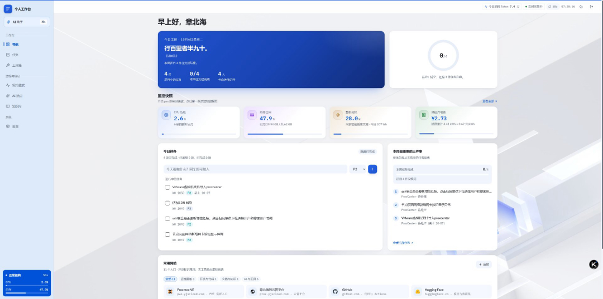

# Personal Workbench · 个人工作台

面向家庭实验室（Home Lab）的**单人控制台**：任务工单、Proxmox VE 监控、AI 热点、知识库与 AI 助手。所有数据存在自己的 MySQL 里，不依赖任何云服务。

A self-hosted, single-user console for homelab operators — tasks, Proxmox VE monitoring, AI news feed, knowledge base and an AI assistant.




## 功能一览

| 页面 | 内容 |
| --- | --- |
| **导航** | 首页搜索框（搜索引擎可在设置里增删、拖动排序）、今日待办、常用网站图标导航、本周最重要的三件事、左上角 AI 助手入口 |
| **任务** | 清单筛选 + 列表/看板双视图 + 任务详情抽屉，支持归档与回收站 |
| **监控数据** | Proxmox VE 主机指标（CPU / 内存 / 磁盘 / IO / 容量趋势 / 温度）、整机功耗与电费（接 [Home Assistant](#依赖说明home-assistant可选) 后为实测值）、节能模式 |
| **AI 热点** | 每日自动抓取的 AI 资讯流，带模型打分与推荐理由 |
| **工具箱** | 工具网站按用途分类，支持搜索与增删改、自定义上传图标，分类可拖动排序或按名称自动排列，与首页共用一份数据 |
| **知识库** | SOP + Runbook，按类型与标签区分 |
| **智能办公** | 直连 Hermes：工位墙与工位详情（配置文档 / 技能 / 进化档案 / **边界守望** / 工作记录 / 即时交互）、全局待办工作表、精确 token 用量、拾贝网页采集（语义抽取 / 清洗 / 失败自愈） |
| **桌宠** | 右下角常驻的鲸娘：盯 DeepSeek 余额、摸头 / 投喂 / 签到 / 闲聊，可拖动、可收起 |
| **设置** | 主题与强调色、PVE 连接、功耗电价模型、搜索源、数据备份 |

## 部署

### 前置要求

- **Node.js 20+**
- **MySQL 8**
- **Home Assistant**（可选）—— 只为读取智能插座的真实功耗，不配也能跑，功耗改用估算模型。见下方[依赖说明](#依赖说明home-assistant可选)

### 1. 建库建账号

```bash
openssl rand -hex 24          # 生成数据库口令
# 把 server/db/bootstrap.sql 里的 __DB_PASSWORD__ 换成它，再执行：
mysql -uroot -p < server/db/bootstrap.sql
```

会创建 `personal_workbench` 库与只允许本机登录的 `workbench` 账号（最小权限：增删改查 + 建表补列，不含 DROP）。同一个口令要写进 `.env` 的 `DB_PASSWORD`。

**3306 不要对外**。应用和数据库在同一台机器上，数据库没有理由出现在局域网扫描结果里：

```ini
# /etc/my.cnf.d/99-bind-local.cnf
[mysqld]
bind-address=127.0.0.1
```

```bash
systemctl restart mariadb
ss -lntp | grep 3306      # 应该只有 127.0.0.1:3306
```

Docker 部署时同理：不要用 `-p 3306:3306`，用 compose 内部网络，或映射成 `-p 127.0.0.1:3306:3306`。

### 2. 安装依赖并配置

```bash
npm install
cp .env.example .env
```

编辑 `.env`。**只有 MySQL 连接是必填的**，其余留空即可跑起来 —— 没配 Proxmox 时自动进入演示模式，用模拟数据把界面跑通。

### 3. 启动

开发模式（前端热更新 + 后端自动重启）：

```bash
npm run dev
# 前端 http://localhost:5173   后端 http://localhost:8787
```

生产模式（单端口，前端产物由后端托管）：

```bash
npm run build
npm start
# http://localhost:8787
```

首次启动会自动建表并写入示例数据。

### 4. 常驻运行（可选）

`/etc/systemd/system/personal-workbench.service`：

```ini
[Unit]
Description=Personal Workbench
After=network.target mysql.service

[Service]
Type=simple
WorkingDirectory=/opt/personal-workbench
ExecStart=/usr/bin/node server/index.js
EnvironmentFile=/opt/personal-workbench/.env
Restart=always
RestartSec=5

[Install]
WantedBy=multi-user.target
```

```bash
systemctl daemon-reload
systemctl enable --now personal-workbench
```

改完代码要上线，一条命令走完类型检查 → 构建 → 重启 → 探活：

```bash
scripts/build-restart.sh
```

容易漏的是**最后一步**：`dist/` 是服务直接从磁盘读的，所以 `npm run build` 一跑完界面就已经是新的了，
而后端的新路由要等重启才生效 —— 漏了的表现是"页面上是新按钮，点下去 404"，看起来像前端坏了。
脚本把这一串绑成一步，并且构建失败就不重启（线上仍是完整的旧版本）。`--no-build` 只重启，
`--help` 看全部选项。

> **放在 nginx 后面时**：若用 AI 助手的流式问答，`proxy_read_timeout` 必须大于 `AI_TIMEOUT_MS`，
> 否则连接会先被反代掐断，前端只能收到 504。另外 `index.html` 不要设长缓存
> （`/assets/` 下的文件带哈希，长缓存是安全的）。
>
> 还有一处**必须单独放行**：书签图标的地址要允许长缓存，它的语义和 `/api/` 的 `no-store`
> 正好相反。漏了这一步，每次刷新每个磁贴都要重新下载一遍图标，界面上就是"图标闪一下"
> （地址带内容版本号，所以长缓存是安全的）。它得写成正则、放在 `/api/` 之前才对得上：
>
> ```nginx
> location ~ ^/api/bookmarks/[^/]+/icon$ {
>     proxy_pass        http://127.0.0.1:8787;
>     proxy_set_header  Host $host;
>     # 上游会发自己的 Cache-Control，丢弃后只保留下面这个（否则会叠成两个头）
>     proxy_hide_header Cache-Control;
>     add_header Cache-Control "public, max-age=31536000, immutable" always;
> }
> ```

### 5. 对外只走 HTTPS

应用默认 `HOST=127.0.0.1`：**8787 不是对外端口**，只给本机 nginx 反代用。直接
暴露 8787 等于把登录接口和全部 API 放在明文 HTTP 上，同网段抓包就能拿走口令与
会话 Cookie —— 域名那边配了 HTTPS 也拦不住有人按 IP 直连。

nginx 侧对应要做两件事：

```nginx
# 1) 80 全部跳 HTTPS（保留路径与查询串）
server {
    listen      80 default_server;
    server_name _;
    return 301 https://demo.example.com$request_uri;
}

# 2) 443 加 HSTS，让浏览器记住"这个站只走 HTTPS"
add_header Strict-Transport-Security "max-age=31536000; includeSubDomains" always;
```

内网若只有 IP、没有证书，宁可只走带证书的域名，也不要为了方便在 IP 上保留明文
入口：那等于给局域网里的每一台设备（包括被入侵的 IoT）留了一条可嗅探的登录通道。
容器部署时不要 `-p 8787:8787`，要映射也只映射到宿主回环：
`-p 127.0.0.1:8787:8787`。

## 环境变量

完整清单和注释见 [`.env.example`](.env.example)。常用的几组：

| 变量 | 说明 |
| --- | --- |
| `DB_HOST` `DB_PORT` `DB_USER` `DB_PASSWORD` `DB_NAME` | MySQL 连接（**必填**） |
| `PORT` `HOST` | 服务端口（默认 `8787`）与监听地址（默认 `127.0.0.1`，只给本机反代用） |
| `AUTH_USER` `AUTH_PASSWORD` | 面板登录账号；`AUTH_PASSWORD` 留空即关闭登录 |
| `HEALTH_TOKEN` | 可选。带 `X-Health-Token` 才返回 `/api/health` 的详细诊断（默认只回状态与 uptime） |
| `PVE_HOST` `PVE_TOKEN_ID` `PVE_TOKEN_SECRET` | Proxmox VE 连接，留空走演示模式 |
| `PVE_CA_FILE` | 可选。PVE 私有 CA 的路径（默认 `server/data/pve-ca.pem`），有它才能开着证书校验连自签的 PVE |
| `HA_URL` `HA_TOKEN` | Home Assistant，读取智能插座的真实功耗（可选，见[依赖说明](#依赖说明home-assistant可选)） |
| `AI_BASE_URL` `AI_API_KEY` `AI_MODEL` | 任意 OpenAI 兼容端点（官方 API / Ollama / vLLM 均可） |
| `HERMES_API_BASE_URL` `HERMES_API_KEY` | 局域网 Hermes 网关（可选）。Key 取自 Hermes 主机的 `~/.hermes/.env` 里的 `API_SERVER_KEY` |
| `HERMES_LOCAL_HOST` `HERMES_LOCAL_USER` `HERMES_LOCAL_KEY` | Hermes 主机的 SSH 只读通道，用于用量 / 待办 / 配置 / 守望等本机数据 |
| `HERMES_BRIDGE_PATH` | 远端数据桥脚本路径（默认 `/data/personal-workbench-bridge/hwb-bridge.cjs`，用 `npm run bridge:deploy` 部署） |
| `DEEPSEEK_API_KEY` `DEEPSEEK_BASE_URL` | DeepSeek 余额（桌宠用），留空则桌宠不显示余额，见[桌宠](#桌宠右下角的鲸娘) |

## 依赖说明：Home Assistant（可选）

**整机功耗与电费默认是估算出来的**，想拿到真实读数就要接 Home Assistant —— 通过智能插座读实测功率。

不配 HA 时，功耗走「CPU 利用率 → 功耗」的工程估算模型；配上之后：

- **整机功耗** = 各插座实测功率之和
- **用电量与电费** = 对上面的求和功率做积分，按电价折算（也可读插座自带的累计电量实体）

### 配置步骤

1. 在 Home Assistant 生成长期访问令牌：**左下角头像 → 安全 → 长期访问令牌**
2. 写进 `.env`：

   ```bash
   HA_URL=http://127.0.0.1:8123
   HA_TOKEN=你的长期访问令牌
   ```

3. 到 **设置 → 功耗 → 插座列表** 添加插座：每个插座填一个**功率实体**（如 `sensor.plug_electric_power`），
   可再加一个**累计电量实体**，留空则由服务端对功率做积分。支持多个插座，整机功耗是它们的和。

### 几点说明

- **令牌只从环境变量读取**，不落库、也不进备份导出；设置页只显示「已配置 / 未配置」，不会回显令牌本身。
- `HA_POWER_ENTITY` / `HA_COUNTER_ENTITY` 是旧版单插座配置的兜底，仅当插座列表为空时才会被读。
- 电量累计依赖服务持续运行，**停机期间不补算**（避免虚增）。
- 没接 HA、或插座读不到数时，界面会明确标注数据来源，不会拿估算值冒充实测。

## 桌宠：右下角的鲸娘

界面右下角常驻一只鲸娘。她只做两件事，其余都是附带的：

### 1. 盯 DeepSeek 余额（要办的正事）

顶上那颗余额标读的是 **DeepSeek 官方 `GET /user/balance`**，由服务端代取：

- **API Key 只在服务端**（`.env` 里的 `DEEPSEEK_API_KEY`）。浏览器侧拿不到它，
  接口 `/api/pet/balance` 回的是一个已经归一化好的余额对象；
- 服务端有 60 秒内存缓存，所以桌宠按时轮询也打不穿上游；读失败时按 5 分钟
  重试（Key 错、欠费这类事不会自己好，撞得太勤只是白烧日志）；
- **按天记一笔快照**（表 `pet_balance`）。余额接口只回答"此刻还剩多少"，
  而真正要盯的是消耗 —— 今日消耗由「上一个有读数的那天的收盘值 − 今天最新值」
  推出来，面板里还能看到最近两周的读数走势；
- **算的是"还能撑多久"，不只是"还剩多少"**。同样的 18 块，一天花 2 块能用一周，
  一天花 9 块只够两天 —— 面板里低于一周时会挂一行天数，撑不过一周她还会主动说一句。
  （余额已经偏低时不说这句，两条提醒会抢同一个气泡，存量告急更要紧。）
- 低于阈值会举牌提醒（每天一次）；**读失败也会说一声**（6 小时冷却）——
  否则 Key 撤销、代理挂掉这类事只会让那颗标安静地变成"待读取"，没人会发现监控停了。
  阈值、是否关心、是否显示数字都能关。

**不想让金额出现在截图里**：关掉「显示余额数字」，界面上就只剩档位措辞
（很充裕 / 还够用 / 快见底 / 已用尽），悬停明细和趋势柱也一起藏掉。

### 2. 日常交互（24 张立绘）

立绘在 `src/assets/pet/states/`：24 张，与智能工位那几位员工同一套人设与画风
（青蓝渐变双马尾、鲸鳍耳、呆毛、白色蕾丝女仆头箍、藏青女仆裙与白围裙、身后一条鲸尾）。
**一次只显示一张**，换哪张由状态决定：

| 什么时候换 | 换成 |
| --- | --- |
| 摸头 | `pat`（眯眼笑）；4 秒内再摸是 `shy`（捂脸） |
| 连点 3 下 / 5 下 | `star`（星星眼）/ `surprise`（骑上大鲸鱼） |
| 投喂 / 夸夸 / 签到 | `feed`（咬饼干）/ `love`（爱心眼）/ `checkin`、连签 ≥3 是 `streak` |
| 待办清空 / 羁绊升级 / 好感度每到 25 | `celebrate` / `levelup` / `gift`（把小鲸鱼递给你） |
| 拖着走 / 机器负载高 / 中等 | `drag` / `work`（抱笔记本）/ `watch`（拿放大镜看图表） |
| 余额告急 / 读不到数 | `alert`（举牌）/ `error`（抱头） |
| 时段 | 早间 `morning`、深夜 `night`、凌晨 `swim`（缩在气泡里） |
| 季节 | 12–2 月 `winter` |
| 闲置 15 分钟 | `sleep`（抱着玩偶睡着） |
| 其余 | `idle` ⇄ `plush` 每 90 秒轮换，免得像张贴纸 |

交互清单：左键摸头、按住拖拽（位置会记住，右键菜单可回到原位）、右键菜单
（投喂 / 夸夸 / 签到 / 看余额 / 设置 / 先下去休息）。另外会按时间打招呼
（挥手）、5–8 分钟闲聊一次、离开超过三分钟回来说一句 —— 但**机器负载高的时候
她会抱着笔记本闭嘴**，深夜默认静音，你也别想在她这儿连着刷好感度
（摸头 4 秒冷却、夸夸 20 秒）。收起之后右下角留一张她的脸，点一下叫回来。

**这 24 张是生成出来的，不是画出来的**，所以提示词里冻结了一份逐字不变的角色
描述（只换姿势那一段），切图时再统一规格：抠底 → 裁到主体 → 按身高缩放到同一
比例 → 脚落在同一条底线上。不归一的话换姿势时她会忽大忽小，单看一张没问题、
动起来很明显。要重新生成或改造型，`src/components/PetWhale.tsx` 顶部那段注
释里写着完整的约束条件。

### 数据与隐私

| 项 | 说明 |
| --- | --- |
| 偏好与养成数值 | 浏览器 `localStorage`（键 `pet:state`）：心情、好感度、签到、位置、开关 |
| 余额快照 | MySQL 表 `pet_balance`（单行 JSON），服务端写入 |
| 凭据 | 无。DeepSeek 的 Key 从不出现在浏览器侧 |
| 外部请求 | 桌宠自己一个都不发；只有服务端去读余额 |
| 遥测 | 无 |

养成数据**刻意不进备份、也不跨设备同步**：位置换台机器本来就该重算，
而"恢复一次备份把桌宠的心情改回上周三"这种事没人想要。要清掉就在
设置面板里点「重置养成数据」。

## 数据存储

所有数据都在 **MySQL**，不落本地文件。表结构见 [`server/db/schema.sql`](server/db/schema.sql)，服务启动时自动执行（幂等），也可以单独跑：

```bash
npm run db:migrate      # 只建表 / 检查连通性与各表行数，不启动 Web 服务
```

写请求在返回前会等待 MySQL 事务提交，提交失败返回 503 —— 不会出现「界面提示保存成功、库里其实没写」。设置页支持导出 / 导入 JSON、立即落盘与重置为示例数据。

> 内存镜像是写入源头，所以**手工改库之后要重启一次服务**，否则下一次同步会覆盖掉手工改动。通过界面或接口读写不会有这个问题。

## 目录结构

```
server/          Express 服务
  index.js       入口、落库闸门、静态托管、定时任务
  routes.js      全部 REST 接口
  store.js       数据层：内存镜像 + 写穿 MySQL
  seed.js        示例数据
  db/            建库建表、连接池、事务化落库
  services/      PVE 客户端、功耗模型、热点抓取、AI 助手
src/             React 前端
  components/    外壳、AI 助手、桌宠、UI 基础件
  pages/         七个页面
  lib/           API 客户端、全局 store、主题、桌宠状态
docs/            截图
```

## 已知边界

- 演示模式下监控数值由时间驱动的确定性算法生成，用于跑通界面，**不代表真实硬件**；
- 磁盘 IO 与温度依赖 PVE 节点侧的 `lm-sensors` / SMART 配置，缺失时界面标注「未探测到」而非补零；
- 电量累计依赖服务持续运行，停机期间不补算；
- **「智能办公」里的边界守望只读上游结论**：频率评分、字节数判定线、封禁申请单都由网关侧的采集器决定，本服务不复制那套规则。**封禁是真实动作** —— 批准后会在那台网关的 frps 上执行 `ipset add`，所以界面上必须先二次确认，且授权码一次性、6 小时有效；
- **AI 热点的数据来自第三方公开接口 [AIHOT](https://aihot.news)**。个人自用没问题；对外商用或公开再分发前，请先确认其使用条款。

## License

[MIT](LICENSE)
